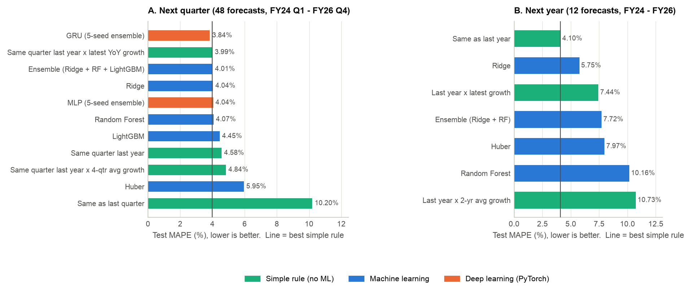
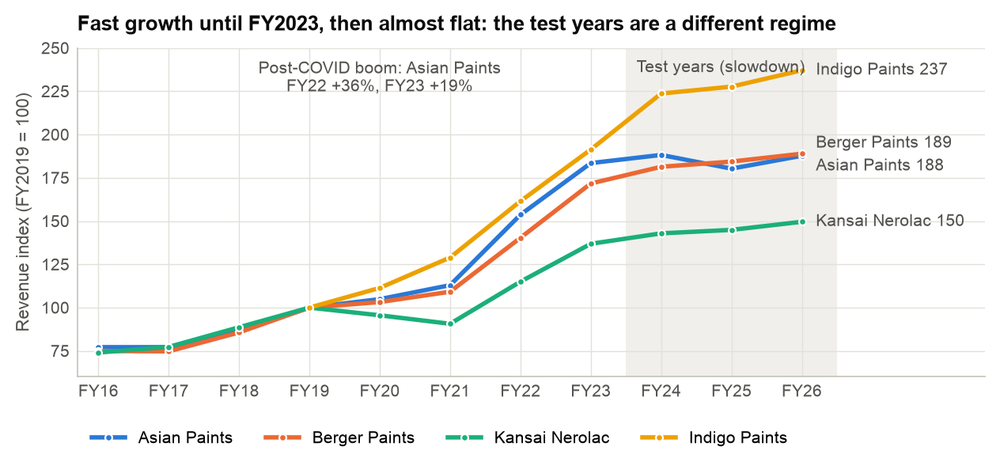
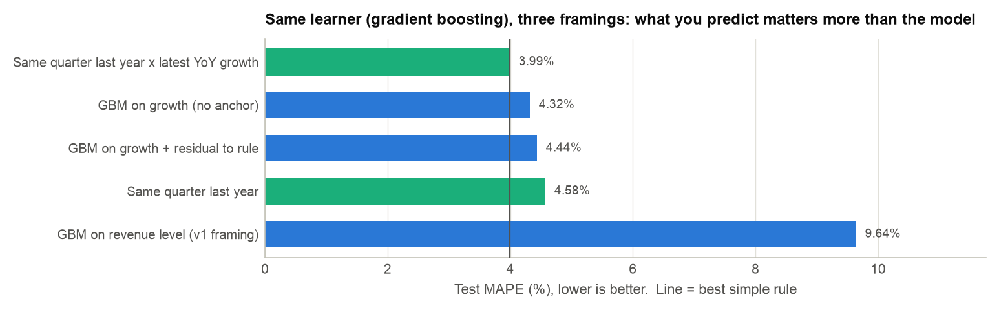
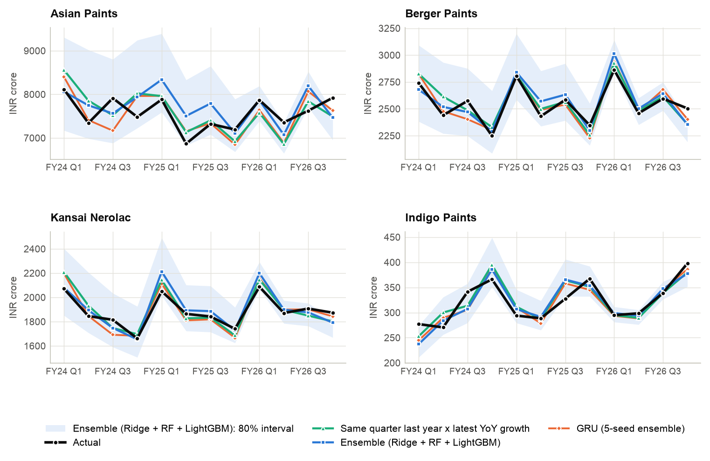
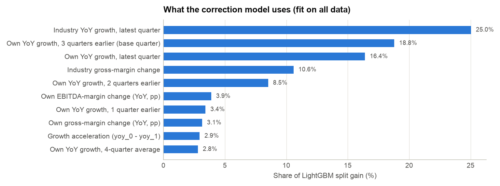
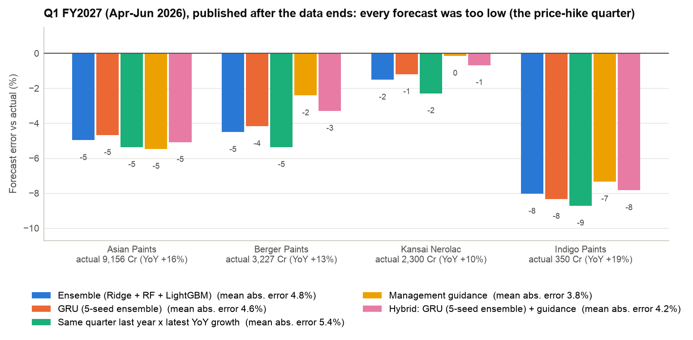

# Forecasting Indian Paint Revenue: ML vs Deep Learning vs Simple Rules vs Management Guidance

> **Can historical financial and operational data of Indian paint companies predict next-period revenue?**

A forecasting study on **Asian Paints, Berger Paints, Kansai Nerolac and Indigo Paints**, built on 12 years of financials
hand-extracted from **211 official filings** (every number traceable to a page). Every model is judged the way a
forecast is used in practice: **walk-forward**, against **simple rules an analyst gets for free**, and finally against a
quarter that was **published after the data ends** and against what **management guided** before it.



## Key findings

| | Result |
|---|---|
| **Simple rules are strong** | "Same quarter last year x latest YoY growth" is only **4.0%** off on average. Any model has to beat that, not zero. |
| **Reframed ML and DL match or slightly beat the rule** | GRU **3.8%**, ML ensemble **4.0%**, Ridge **4.0%** vs rule 4.0% (next quarter, FY2024-26). Gains are small and **not statistically significant** (Diebold-Mariano p > 0.5). |
| **ML helps more in volatile periods** | FY2019-23: ML ensemble **6.9%** vs rule **8.2%** (p about 0.05). |
| **Framing matters more than the algorithm** | The same gradient-boosting model is **9.6%** off when it predicts revenue in crore (the v1 approach) and **4.3%** when it predicts growth. |
| **Annual forecasting: the rule wins** | "Same as last year" (4.1%) beats every ML model; about 20 annual training rows are too few. |
| **Errors come from the economy, not the code** | In the FY2025 demand slowdown the ensemble forecast too high 75% of the time (+3.2% on average); in the FY2027 price-hike quarter it forecast too low. The models only see past financial statements. |
| **Turning points need outside information** | In the price-hike quarter (Q1 FY2027) every forecast was too low. Management guidance was 3.8% off; the best models 3.5-4.8%; v1's model 12.8%. |

**Bottom line.** Past financials predict the *level* and seasonal shape of revenue very well, but most of that skill comes
from the obvious rule. Machine learning adds a small, regime-dependent improvement on top. The big misses come from
events outside the financial statements (price hikes, input-cost shocks, competition), which management guidance does contain.

---

## Contents
[Data](#data) · [Method](#method) · [Results](#results) · [Reality check vs guidance](#reality-check-q1-fy2027-vs-management-guidance) ·
[Why the models miss](#why-the-models-still-make-errors) · [Next-quarter forecast](#forecast-the-next-quarter) ·
[What changed from v1](#what-changed-from-v1) · [Report (PDF)](Indian_Paint_Revenue_Forecasting_Report.pdf) · [Limitations](#limitations-and-next-steps) · [Reproduce](#reproduce) · [Structure](#project-structure)

## Data

| | |
|---|---|
| Companies | Asian Paints, Berger Paints, Kansai Nerolac, Indigo Paints (listed Indian paint makers) |
| Period | FY2015-FY2026 (April-March years); quarterly and annual |
| Source | 211 official filings (166 quarterly results, 42 annual reports, 3 audited statements), no third-party data |
| Traceability | 3,082 values, each with document, page, formula and URL in `data/processed/sources.csv` |
| Basis used | Standalone (exists for every period; bases are never mixed): **169 company-quarters, 45 company-years** |

Full documentation: [dataset](docs/dataset.md) · [data dictionary](docs/data_dictionary.md) · [data-quality report](docs/data_quality_report.md).



The training years include the post-COVID boom; the test years (FY2024-26) were a slowdown, with a new competitor
(Birla Opus, February 2024) and a price war. A model that learns "revenue grows about 12% a year" fails here.

## Method

### 1. Framing: predict growth, not crore
Each row is a forecast made at the end of quarter *t* for quarter *t+1*. The target is next quarter's **year-on-year log growth**

```
y = log(revenue[t+1]) - log(revenue[t-3])        forecast = revenue[t-3] x exp(y_hat)
```

Predicting crore lets a model look accurate just by knowing that Asian Paints is 20x bigger than Indigo (a "model" that
only knows each company's average revenue scores R² = 0.999). Predicting growth removes that shortcut and lets one model
serve all four companies.

The ML and DL models learn a **correction to the best rule**: their target is `y - latest YoY growth`. A model that finds no
signal falls back to the rule instead of drifting to the training-period average.

### 2. Features (all from data up to quarter *t*)
| Group | Features |
|---|---|
| Own growth | YoY growth of the latest 4 quarters, 4-quarter average, acceleration. The growth 3 quarters ago is the growth of the target's base quarter (base effects). |
| Profitability | Year-on-year change in gross margin and EBITDA margin (raw-material pressure often precedes price hikes) |
| Industry | Average YoY growth and gross-margin change across the four companies in the same quarter |
| Calendar / entity | Target-quarter dummies (Q3 = festive season), company dummies |
| GRU only | The same signals as a 4-quarter sequence |

**COVID handling.** Training rows whose target, base or input quarter is a lockdown quarter (FY2020 Q4, FY2021 Q1, FY2022 Q1)
are dropped. Growth inputs are capped at ±0.35 log points (the largest non-COVID quarter is 0.31; lockdown quarters reach -0.90 and +0.78).

### 3. Models
| Family | Models |
|---|---|
| Simple rules | Same as last quarter · Same quarter last year · Same quarter last year x latest YoY growth · ... x 4-quarter average growth |
| Machine learning | Ridge (alpha by time-series CV) · Huber · Random Forest · LightGBM (small-data settings) · equal-weight Ensemble (Ridge + RF + LightGBM) |
| Deep learning (PyTorch) | **MLP** (2 hidden layers, 32-16) · **GRU** (16 units over 4 quarters + static inputs). Both are small on purpose (1,153 and 1,473 weights for ~150 rows), use AdamW + Huber loss, early-stop on the most recent *training* quarters, refit on all training rows, and average a **5-seed ensemble** |
| Ablation | Gradient boosting on revenue level (v1 framing) · on growth · on growth as a residual to the rule |
| Guidance | Management guidance from the May 2026 earnings calls; and a hybrid (average of the best model and guidance) |

### 4. Walk-forward evaluation
At every forecast origin each model is **re-trained only on quarters whose results were already published**, then forecasts
the next quarter; the origin then moves forward one quarter. This runs from FY2019 Q1 to FY2026 Q4:

* **Test window:** FY2024 Q1-FY2026 Q4 (48 quarterly forecasts; 12 annual).
* **Earlier window:** FY2019 Q1-FY2023 Q4, COVID-affected targets removed (39 forecasts), used as a robustness check.

**Metrics:** MAPE; MAE in crore; **Relative MAE** (model MAE ÷ "same quarter last year" MAE; < 1 is better); a
**Diebold-Mariano test** (Harvey-Leybourne-Newbold corrected) against the best rule; MAPE per company; and the coverage of
80% prediction intervals built from each model's own recent out-of-sample errors.

**Leakage tests** (`tests/`): scrambling every value after FY2023 Q4 must leave all earlier features unchanged; the walk-forward
must never train on a target later than the forecast origin; plus target, baseline and metric checks.

## Results

### Next quarter: test window FY2024 Q1-FY2026 Q4 (48 forecasts)

| Model | Family | MAPE | MAE (Cr) | Rel. MAE | DM p-value vs best rule |
|---|---|---:|---:|---:|---:|
| GRU (5-seed ensemble) | Deep learning | **3.84%** | 113 | 0.89 | 0.58 |
| Same quarter last year x latest YoY growth | Rule | 3.99% | 122 | 0.95 | n/a |
| Ensemble (Ridge + RF + LightGBM) | ML | 4.01% | 125 | 0.98 | 0.85 |
| Ridge | ML | 4.04% | 128 | 1.00 | 0.70 |
| MLP (5-seed ensemble) | Deep learning | 4.04% | 117 | 0.91 | 0.79 |
| Random Forest | ML | 4.07% | 130 | 1.02 | 0.70 |
| LightGBM | ML | 4.45% | 142 | 1.11 | 0.36 |
| Same quarter last year | Rule | 4.58% | 128 | 1.00 | 0.77 |
| Huber | ML | 5.95% | 188 | 1.47 | 0.06 |
| Same as last quarter | Rule | 10.20% | 260 | 2.03 | < 0.001 |

### Robustness: earlier window FY2019-FY2023 (39 forecasts, COVID targets removed)

| Model | MAPE | DM p-value vs best rule |
|---|---:|---:|
| Ensemble (Ridge + RF + LightGBM) | **6.89%** | 0.05 |
| Ridge | 6.94% | 0.13 |
| Random Forest | 7.03% | 0.05 |
| LightGBM | 7.04% | 0.06 |
| GRU (5-seed ensemble) | 7.62% | 0.40 |
| MLP (5-seed ensemble) | 7.83% | 0.81 |
| Same quarter last year x latest YoY growth | 8.18% | n/a |

ML beats the rule when growth swings around (recovery and boom); in the flat test years it roughly ties. The **ensemble is
the most consistent model** (first in the earlier window, a close third in the test window); the GRU wins the test window but
ranks fifth earlier.

### Next year: test window FY2024-FY2026 (12 forecasts)

| Model | MAPE |
|---|---:|
| Same as last year | **4.10%** |
| Ridge | 5.75% |
| Last year x latest growth | 7.44% |
| Ensemble (Ridge + RF) | 7.72% |
| Huber | 7.97% |
| Random Forest | 10.16% |

With about 20 annual training rows, ML cannot learn a stable pattern, so no annual deep-learning model is built. The annual
ML forecasts for FY2027 (+9% to +22%) are saved for transparency but should not be trusted.

### Framing ablation: same learner, three targets



Predicting revenue in crore (v1) is about **2.2x less accurate** than predicting growth with the *same* algorithm, and
worse than the simplest rule.

### Forecasts vs actuals in the test window



**Prediction intervals.** 80% intervals from each model's 32 most recent out-of-sample errors cover 85% (Ridge), 83%
(Ensemble) and 81% (LightGBM) of test outcomes at an average width of about 19% of the forecast; the deep-learning
intervals are slightly conservative (96%).

### What the correction model uses



Industry-wide growth and the base-quarter effect carry most of the signal; margin changes add a little.

## Reality check: Q1 FY2027 vs management guidance

Q1 FY2027 (April-June 2026) results were published in July-August 2026, **after the dataset ends**, so these are true
out-of-sample forecasts. In May 2026, management said the industry had raised prices by about 12%, Asian Paints guided 8-10%
volume growth, and dealers were stocking up ahead of the hikes. [`management_guidance_may2026.csv`](data/external/management_guidance_may2026.csv)
turns that into one implied growth rate (+10%, a conservative reading); edit it to test other readings.



| Forecast | Mean abs. error (4 companies) |
|---|---:|
| Huber (ML) | 3.5% |
| **Management guidance** | **3.8%** |
| LightGBM | 4.1% |
| Hybrid: GRU + guidance | 4.2% |
| MLP / GRU (deep learning) | 4.6% |
| Ensemble (Ridge + RF + LightGBM) | 4.8% |
| Same quarter last year x latest YoY growth | 5.4% |
| v1 best model (gradient boosting on revenue level) | 12.8% |
| v1 deep-learning model | 24.6% |

Actual growth was 10% to 19% year on year. Every forecast was too low, and for 3 of 4 companies the actual landed at or
above the top of the ensemble's 80% interval: a genuine shock. Huber topping this one quarter is luck (it is the weakest ML
model over the 48-quarter test). Four numbers are an anecdote, not a benchmark, but they show where the remaining error comes from.
Actuals and their sources are in [`actuals_q1fy27.csv`](data/external/actuals_q1fy27.csv).

## Why the models still make errors

The remaining errors are mostly not modelling mistakes. They come from things that move revenue but never appear in the
companies' past financial statements, which are the only inputs the models get.

| When | What the models did | What was really happening |
|---|---|---|
| FY2025 (Q1-Q3) | Forecast too high in 75% of cases, by +4% to +6% | A demand slowdown: weak urban demand, customers trading down to cheaper paints, and a price war after a new competitor (Birla Opus) entered in February 2024. Asian Paints' revenue fell 4% in FY2025. |
| FY2026 Q4 and FY2027 Q1 | Forecast too low, by -1% to -8% | Demand recovered and crude-linked raw-material prices jumped (Indigo Paints said some rose 50-100% in March 2026), so the industry raised prices by about 12% and dealers stocked up before the hikes. |

**What the models cannot see:**
* **The economy and demand:** housing and real-estate activity, urban vs rural spending, consumer confidence.
* **Prices and costs:** announced price hikes, crude oil and titanium-dioxide prices, the rupee.
* **Competition:** new entrants, price cuts, and higher dealer and painter discounts, which are deducted from revenue.
* **Channel effects:** dealers buying ahead of price hikes (revenue pulled forward) or cutting stock in a slowdown.
* **Weather and calendar:** the monsoon and the timing of the festive season shift demand between quarters.

Because the models learn only from reported numbers, they notice a turn one or two quarters late: they keep forecasting
the old trend when demand slows and miss the jump when prices rise. Management guidance already contains much of this
information, which is why it came out slightly ahead in Q1 FY2027. Adding these drivers is the main next step.

## Forecast the next quarter

```bash
python scripts/predict.py              # recommended model, GRU and the simple rule
python scripts/predict.py --markdown   # the same as a Markdown table
```

The models are trained on every quarter in `data/processed/` and forecast the first quarter after it. The 80% range comes
from each model's own recent walk-forward errors. When the actual result for that quarter is known
([`actuals_q1fy27.csv`](data/external/actuals_q1fy27.csv)), it is shown next to the forecast. Output (also saved to
`reports/results/next_quarter_forecast.csv`):

Forecast for **FY2027 Q1** (standalone revenue, INR crore; data through FY2026 Q4).

| Company | Model | Forecast | 80% range | YoY growth | Actual | Error |
|---|---|---:|---:|---:|---:|---:|
| Asian Paints | Ensemble (Ridge + RF + LightGBM) | 8,701 | 8,105 - 9,093 | +10.6% | 9,156 | -5.0% |
| Asian Paints | GRU (5-seed ensemble) | 8,727 | 8,384 - 9,163 | +10.9% | 9,156 | -4.7% |
| Asian Paints | Same quarter last year x latest YoY growth | 8,665 | 8,352 - 9,072 | +10.1% | 9,156 | -5.4% |
| Berger Paints | Ensemble (Ridge + RF + LightGBM) | 3,081 | 2,870 - 3,220 | +7.6% | 3,227 | -4.5% |
| Berger Paints | GRU (5-seed ensemble) | 3,092 | 2,971 - 3,246 | +8.0% | 3,227 | -4.2% |
| Berger Paints | Same quarter last year x latest YoY growth | 3,054 | 2,943 - 3,197 | +6.7% | 3,227 | -5.4% |
| Kansai Nerolac | Ensemble (Ridge + RF + LightGBM) | 2,265 | 2,110 - 2,367 | +8.5% | 2,300 | -1.5% |
| Kansai Nerolac | GRU (5-seed ensemble) | 2,272 | 2,183 - 2,385 | +8.8% | 2,300 | -1.2% |
| Kansai Nerolac | Same quarter last year x latest YoY growth | 2,247 | 2,166 - 2,353 | +7.6% | 2,300 | -2.3% |
| Indigo Paints | Ensemble (Ridge + RF + LightGBM) | 322 | 300 - 336 | +9.2% | 350 | -8.0% |
| Indigo Paints | GRU (5-seed ensemble) | 321 | 308 - 337 | +8.8% | 350 | -8.3% |
| Indigo Paints | Same quarter last year x latest YoY growth | 319 | 308 - 335 | +8.4% | 350 | -8.7% |

The forecasts sit 1-9% below the actual results, and for most companies the actual is near or above the top of the
80% range. The April-June 2026 price-hike quarter is exactly the kind of shock described above. To forecast a later
quarter, append that quarter's results to `data/processed/quarterly_reported.csv` and rerun.

## What changed from v1

The first version of this project (kept in [`legacy/`](legacy/)) reported R² of 0.96-0.99. An audit
([v1 audit report](reports/v1_audit_report.pdf)) showed that every v1 model was less accurate than copying last year's number.

| | v1 (`legacy/`) | v2 (this repo) |
|---|---|---|
| Target | Revenue in crore | Next-quarter YoY growth, as a correction to the best rule |
| Baselines | None | 4 quarterly and 3 annual rules, reported first |
| Validation | One train/test split; DL early-stopped **on the test set** | Walk-forward re-training every quarter; DL validated on the last training quarters |
| Headline metric | Pooled R² (dominated by company size) | MAPE, relative MAE, Diebold-Mariano test, per-company MAPE, interval coverage |
| Seasonal anchor | Missing (no lag-3 for a t+1 target) | Built into the target |
| COVID | Not handled | Lockdown-touched rows dropped; growth inputs capped |
| Deep learning | One 4-layer MLP (14k weights, 121 rows), single seed | Small MLP and GRU, 5-seed ensembles |
| Best next-quarter MAPE | 9.8% (worse than the 4% rule) | 3.8% (GRU) / 4.0% (Ensemble) |
| Q1 FY2027 out-of-sample | 12.8% (GB), 24.6% (DL) | 4.6-4.8% (GRU, Ensemble) |
| Tests | None | Leakage and correctness unit tests |

## Limitations and next steps

**Limitations**
* Small panel: four companies, about 150 usable quarterly rows. Differences between the top models are within noise.
* Only financial-statement inputs. Price hikes, crude and TiO2 prices, competition and demand are not in the data.
* One choice was made after seeing test results: the interval window (32 recent errors) replaced an expanding window that over-covered. Model choices and hyperparameters were fixed before that.
* Q1 FY2027 actuals come from press coverage of the companies' results (Asian Paints: standalone net sales); check them against exchange filings.
* The guidance number (+10%) is a judgement call; that is why it lives in an editable CSV.

**Next steps**
1. Add external drivers: announced price hikes, crude and TiO2 prices, INR/USD, monsoon, housing sales.
2. Extract guidance (volume growth, price actions) from earnings-call transcripts with an LLM and use it as a feature.
3. Forecast annual revenue by aggregating quarterly forecasts instead of training on 20 annual rows.
4. Add more companies (unlisted peers, other building-material sectors) to give the models more data.

## Reproduce

```bash
git clone https://github.com/jatinbhalla2324/Indian-Paint-ML-DL-project-analysis.git
cd Indian-Paint-ML-DL-project-analysis
python -m venv .venv && source .venv/bin/activate
pip install -r requirements.txt

python scripts/run_all.py            # every result and figure (about 1 minute on a laptop CPU)
python scripts/predict.py            # next-quarter forecast for each company, with an 80% range
python -m unittest discover tests    # leakage and correctness tests
```

Results are written to `reports/results/` (CSV) and figures to `reports/figures/`. Runs are deterministic on CPU.
[`notebooks/walkthrough.ipynb`](notebooks/walkthrough.ipynb) walks through the analysis step by step.

## Project structure

```
paint_forecast/                 the v2 package
  config.py                     paths, windows, COVID quarters, constants
  data.py                       load the reported financials into a company x period panel
  features.py                   leakage-safe features; growth target
  models.py                     rules, ML models (residual to the rule), ablation models
  deep.py                       PyTorch MLP and GRU with early stopping, refit and seed ensembles
  backtest.py                   walk-forward evaluation and rolling prediction intervals
  metrics.py                    MAPE, relative MAE, Diebold-Mariano test, per-company tables
  guidance.py                   management-guidance and hybrid forecasts, scoring vs actuals
  pipeline.py                   end-to-end run and next-period forecasts
  plots.py                      README figures
scripts/run_all.py              reproduce every result and figure
scripts/predict.py              forecast the next quarter with an 80% range
tests/test_pipeline.py          leakage and correctness tests
notebooks/walkthrough.ipynb     narrative walkthrough (executed)
data/processed/                 the dataset (see docs/)
data/external/                  management guidance (May 2026) and Q1 FY2027 actuals, with sources
reports/results/                every table behind this README (CSV)
reports/figures/                figures
reports/v1_audit_report.pdf     audit of the first version
Indian_Paint_Revenue_Forecasting_Report.pdf   project report (PDF)
legacy/                         v1 code and notebooks, unchanged except for portable data paths
docs/                           dataset documentation
```

---

*Author: Jatin Bhalla ([@jatinbhalla2324](https://github.com/jatinbhalla2324)). This is a learning project, not investment advice.*
